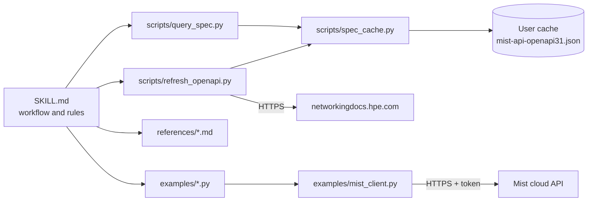
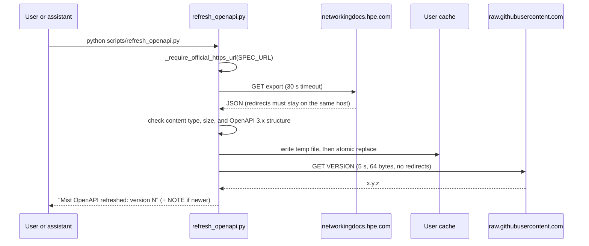

# Implementation guide

**TL;DR:** This project is an assistant skill. `SKILL.md` tells the assistant what to do. Three Python scripts download and query Juniper's Mist OpenAPI file. Five Python examples show safe Mist REST code. A test suite and six checks protect all of it.

> Documents **v1.0.1** (`d46dafd`) · Doc revision **1** · Updated 2026-11-18
> Latest change: First version of this guide.

This guide is for people who change the project. For people who use it, see [usability.md](usability.md).

## Overview

The skill helps an AI coding assistant work with the Juniper Mist API. The assistant does not guess endpoint details. It queries a local copy of the official OpenAPI file and reads tested example code. The scripts only read API documentation. The examples connect to a Mist organization only when a person runs them with a token.

## Architecture



*The assistant reads `SKILL.md`, then uses the scripts for API facts and the examples for code.*

| Component | Purpose |
| --- | --- |
| `SKILL.md` | The assistant's instructions: evidence order, query steps, write safety, and response shape. |
| `references/` | Detailed guides. The assistant loads one only when its topic applies. |
| `scripts/refresh_openapi.py` | Downloads, validates, and caches the OpenAPI file. Also runs an optional update check. |
| `scripts/query_spec.py` | Prints small, bounded parts of the cached OpenAPI file. |
| `scripts/spec_cache.py` | Shared helper: cache location, size limit, and document validation. |
| `examples/mist_client.py` | Shared REST client: host checks, token handling, retries, and pagination. |
| `examples/*.py` (other four) | Runnable patterns that import `mist_client.py`. |
| `tools/check_secrets.py` | Scans tracked files and Git history for secrets. |
| `agents/openai.yaml` | Display name and default prompt for assistants that read this file. |

## Repository map

| Path | Contents |
| --- | --- |
| `SKILL.md` | Skill entry point. The `name: mist-api` front matter is the skill ID. |
| `scripts/` | OpenAPI download and query tools. Standard library only. |
| `examples/` | REST, CSV, WLAN, and webhook examples. Need `requests`. |
| `references/` | `openapi.md`, `implementation-patterns.md`, `safety-and-troubleshooting.md`, `event-integrations.md`, `terraform.md`. |
| `tests/` | `pytest` suite. Uses fake clients, fake openers, and local servers. No live tenant. |
| `tools/` | `check_secrets.py`. |
| `docs/` | This guide, the usability guide, and the security audit. |
| `VERSION` | Skill version, `x.y.z`. The update check compares it. |
| `.github/` | CI workflow and Dependabot settings. |

## Data and control flow

### OpenAPI download



*A failed download never replaces a valid cache. The update check runs only after a successful download.*

- `refresh_spec()` streams the response into a private temporary file in the cache folder. It validates the file before it replaces the cache.
- `spec_cache.validate_document()` requires `openapi: 3.x`, an `info.title` that contains "Mist", a version, at least one path, and at least one component schema. `MAX_SPEC_BYTES` is 64 MiB.
- `check_for_skill_update()` fails silently. `MIST_SKILL_UPDATE_CHECK=0` and `--offline` turn it off.

### OpenAPI query

`query_spec.py` loads the cache through `spec_cache`. It then runs one sub-command: `info`, `find`, `show`, `operation`, `schema`, `tags`, or `tag`. Each command returns a `CommandOutput`. `_render_text()` and `_render_json()` apply the `--max-chars` limit. JSON output stays valid when it is shortened (see [references/openapi.md](../references/openapi.md)).

### REST examples

`MistClient` validates the base URL before it builds the `Authorization` header. It retries only `GET`, `HEAD`, and `OPTIONS` on 429, 500, 502, 503, and 504, with a limit and jitter. `paginate()` walks `page`/`limit` endpoints with a page limit. `MistAPIError` carries a status code but never a response body.

## Key design decisions

| Decision | Reason (from code, tests, and history) |
| --- | --- |
| The OpenAPI file is downloaded, not bundled. | It is large vendor material with its own terms (see `NOTICE`). |
| The download host is pinned to one HTTPS host, and redirects to other hosts are blocked. | Only the official source can fill the cache. When Juniper moved the file to `networkingdocs.hpe.com` (1.0.1), the pin moved with it. |
| Query output has hard limits. | The full file is about 22 MB. Small answers keep the assistant's context focused. |
| Scripts use only the standard library. | The documentation tools work before anything else is installed. |
| Writes are never retried automatically. | A replayed `PUT` or `POST` can change a tenant twice. |
| The WLAN example treats 5xx, 408, redirects, and transport errors as "unknown outcome". | The server may have applied the change. The example reads back instead of retrying. |
| The webhook receiver refuses non-loopback binds by default. | It is a test harness without TLS. |

## Configuration

Names only. The README has the full table.

| Name | Read by |
| --- | --- |
| `MIST_OPENAPI_PATH` | `spec_cache.py` (absolute cache path) |
| `MIST_SKILL_UPDATE_CHECK` | `refresh_openapi.py` (`0` turns off the update check) |
| `MIST_API_TOKEN`, `MIST_BASE_URL` | REST examples |
| `ORG_ID`, `TARGET_SITE_NAME`, `OUTPUT_CSV`, `SITE_ID`, `WLAN_ID` | REST examples |
| `WEBHOOK_SHARED_SECRET`, `PORT`, `MAX_CONTENT_LENGTH_BYTES` | Webhook receiver |

Default cache paths:

- Windows: `%LOCALAPPDATA%\mist-api\mist-api-openapi31.json`
- macOS: `~/Library/Caches/mist-api/mist-api-openapi31.json`
- Other Unix: `${XDG_CACHE_HOME:-~/.cache}/mist-api/mist-api-openapi31.json`

Lint rules are in `ruff.toml` (`E4`, `E7`, `E9`, `F`, `B`; Python 3.10 target).

## Build, test, run

There is no build step. These commands passed in a clean copy of the repository with Python 3.13:

```bash
python -m venv .venv
.venv/bin/python -m pip install -r requirements-dev.txt
.venv/bin/python -m pytest -q
.venv/bin/ruff check .
.venv/bin/ruff format --check .
.venv/bin/bandit -q -r scripts examples
.venv/bin/pip-audit -r requirements-dev.txt
.venv/bin/python tools/check_secrets.py
```

Observed results:

```text
156 passed, 38 subtests passed
All checks passed!
29 files already formatted
No known vulnerabilities found
Tracked files and reachable Git history: no unexpected secret candidates
```

`.github/workflows/ci.yml` runs the same checks on Python 3.10 and 3.13, plus `pytest` on Windows and macOS. GitHub Actions is currently turned off for the repository, so pull requests show no checks. Run the commands above before you merge.

## Extending

**Add a query command:**

1. Write `cmd_NAME(spec, args) -> CommandOutput` in `scripts/query_spec.py`.
2. Register a sub-parser in `build_parser()`. Add `_add_output_limit()` so the output stays bounded.
3. Add tests to `tests/test_query_spec.py` that use a small synthetic spec.
4. Document the command in `references/openapi.md` and `SKILL.md`.

**Add a REST example:**

1. Create `examples/NAME.py`. Import `MistClient`, `MistAPIError`, and `api_path_segment` from `mist_client`.
2. Read the token from `MIST_API_TOKEN`. Exit with a short message when it is missing.
3. Keep writes behind `--apply` and an exact `--confirm-target` value.
4. Add tests in `tests/test_examples.py` with a fake client.
5. List the example in `SKILL.md` and the README.

**Change the download source:** update `SPEC_URL` and `_OFFICIAL_HOST` together, then update `test_source_is_hardcoded_official_https` and the redirect test.

Every change needs a `CHANGELOG.md` entry (see [CONTRIBUTING.md](../CONTRIBUTING.md)). Raise `VERSION` when users must update.

## Known limits

- The webhook receiver is not a production service. It has no TLS, durable queue, replay protection, or rate limit.
- `paginate()` supports `page`/`limit` endpoints only.
- The query tools read at most 64 MiB. Traversal stops at 10,000 visits or 64 nesting levels.
- Installations on 1.0.0 cannot download the OpenAPI file, because the old host now redirects. Their update check also never runs, because it runs only after a successful download.
