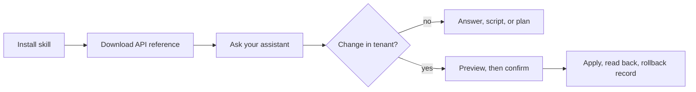

# Usability guide

**TL;DR:** Install the skill in your assistant's skills folder. Run `python scripts/refresh_openapi.py` one time. Then ask your assistant for Mist API help. It checks the real API reference before it writes code, and it asks before it changes anything in your organization.

> Documents **v1.0.1** (`d46dafd`) · Doc revision **1** · Updated 2026-11-18
> Latest change: First version of this guide.

This guide is for people who use the skill. For people who change it, see [implementation.md](implementation.md).

## What you can do

- Ask which Mist API endpoint does a task, and get the exact method, path, parameters, and response type.
- Get a Python or cURL script for a Mist task, built on a tested client.
- Look up one field of a Mist data model, such as the `ssid` of a `wlan`.
- Plan a configuration change with a preview, a confirmation step, and a rollback record.
- Test Mist webhook delivery and signature checks on your own computer.



*The usual path. A change happens only when you confirm it.*

## Before you start

| You need | Why |
| --- | --- |
| An assistant that supports Agent Skills (for example, Claude Code) | It loads `SKILL.md`. |
| Python 3.10 or newer | Runs the scripts and examples. Use `python`, `python3`, or `py -3`. |
| Internet access to `networkingdocs.hpe.com` | The first download of the API reference. |
| A Mist API token (only for the examples) | The examples read it from `MIST_API_TOKEN`. Use the lowest privilege that does the job. |

The documentation tools need no token and do not connect to your Mist organization.

## Getting started

1. Get the source. Clone the repository or download a tagged release archive.
2. Copy the tracked files into your skills folder:

   ```bash
   mkdir -p ~/.claude/skills/mist-api
   git -C mist-api archive HEAD | tar -x -C ~/.claude/skills/mist-api
   ```

   Result: `~/.claude/skills/mist-api/SKILL.md` exists. For one project only, use `.claude/skills/mist-api` in that project.
3. Go to the skill folder and download the API reference:

   ```bash
   python scripts/refresh_openapi.py
   ```

   Result:

   ```text
   Mist OpenAPI refreshed: version 2610.1.0 at <your cache folder>/mist-api-openapi31.json
   ```

4. Ask your assistant a Mist question, for example: "Which endpoint lists the WLANs in my org?"

The version number changes when Juniper publishes a new API reference.

## Task guides

### Check the API reference without a download

1. Run:

   ```bash
   python scripts/refresh_openapi.py --offline
   ```

   Result when a cache exists:

   ```text
   Mist OpenAPI cache: version 2610.1.0 at <your cache folder>/mist-api-openapi31.json (offline)
   ```

   Result when no cache exists (exit code 1):

   ```text
   ERROR: no valid cached Mist OpenAPI document at <your cache folder>/mist-api-openapi31.json
   ```

2. If there is no cache, run `python scripts/refresh_openapi.py`.

### Find an endpoint

Your assistant runs these steps for you. You can also run them yourself.

1. Search by keyword:

   ```bash
   python scripts/query_spec.py find wlans --limit 5
   ```

   Result:

   ```text
   GET     /api/v1/orgs/{org_id}/wlans  - listOrgWlans
   GET     /api/v1/sites/{site_id}/wlans  - listSiteWlans
   GET     /api/v1/sites/{site_id}/wlans/derived  - listSiteWlansDerived
   POST    /api/v1/orgs/{org_id}/wlans  - createOrgWlan
   POST    /api/v1/sites/{site_id}/wlans  - createSiteWlan
   ... (15 more; raise --limit to show them)
   ```

2. Show one endpoint:

   ```bash
   python scripts/query_spec.py show GET "/api/v1/orgs/{org_id}/wlans"
   ```

   Result (shortened):

   ```text
   GET /api/v1/orgs/{org_id}/wlans
   operationId: listOrgWlans
   parameters:
     - org_id (path, string, required)
     - limit (query, integer, optional): Maximum number of results to return per page
     - page (query, integer, optional): Select the page number to return when using page-based pagination; starts at `1`
   responses:
     200: OK  -> array[wlan]
     429: Too Many Request. The API Token used for the request reached the 5000 API Calls per hour threshold  -> allOf[response_http429]
   ```

3. Look up one field of the response model:

   ```bash
   python scripts/query_spec.py schema wlan --property ssid --max-depth 1
   ```

   Result:

   ```json
   {
     "_meta": {
       "max_chars": 6000,
       "reasons": [],
       "truncated": false
     },
     "data": {
       "component": "wlan",
       "property": "ssid",
       "required": true,
       "schema": {
         "description": "Name of the SSID",
         "type": "string"
       }
     }
   }
   ```

Other commands: `info` (version, regional clouds, auth schemes), `operation` (expanded request and response), `tags`, and `tag NAME` (endpoints in a group). [references/openapi.md](../references/openapi.md) explains every output format.

### Run an example script

1. Install the example dependency:

   ```bash
   python -m pip install -r examples/requirements.txt
   ```

2. Set your token in the environment. Do not paste it into chat or a file in the repository.
3. Go to `examples/` and run the example. For example, `python list_sites.py --org-id ORG_ID`.

   Without a token, the example stops before it sends a request (exit code 1):

   ```text
   Set MIST_API_TOKEN in your environment.
   ```

| Example | What it does | Writes to Mist? |
| --- | --- | --- |
| `list_sites.py` | Lists every site in an organization. | No |
| `get_site_devices_to_csv.py` | Exports one site's devices to a CSV file. | No |
| `update_wlan_stub.py` | Previews, applies, or rolls back one WLAN SSID change. | Only with `--apply --confirm-target SITE_ID/WLAN_ID` |
| `webhook_receiver.py` | Receives and verifies Mist webhooks on your computer. | No |

Every example has `--help`.

### Change a WLAN SSID safely

These steps were not run against a live tenant for this guide. They follow the code and the automated tests, which use a fake client.

1. Preview the change. The script reads the WLAN but does not change it:

   ```bash
   python update_wlan_stub.py --site-id SITE_ID --wlan-id WLAN_ID --new-ssid "New name"
   ```

   The preview prints `Target:`, `Current SSID:`, `Proposed SSID:`, and the `PUT` body, then `Dry run complete; no changes applied.`
2. Read the preview. Make sure the site, WLAN, and new name are correct.
3. Apply the change with the exact target:

   ```bash
   python update_wlan_stub.py --site-id SITE_ID --wlan-id WLAN_ID --new-ssid "New name" --apply --confirm-target SITE_ID/WLAN_ID
   ```

   Result: one `PUT`, a read-back, and `wlan_rollback.json` when the change is confirmed.
4. To undo, preview the rollback first, then apply it:

   ```bash
   python update_wlan_stub.py --rollback wlan_rollback.json
   python update_wlan_stub.py --rollback wlan_rollback.json --apply --confirm-target SITE_ID/WLAN_ID
   ```

   Rollback works only when the live SSID still equals the SSID that the record applied.

If the result is "Write outcome is unknown", do not run the change again. Check the WLAN in Mist first. The details are in [references/safety-and-troubleshooting.md](../references/safety-and-troubleshooting.md).

## Common problems

| Symptom | Cause | Fix |
| --- | --- | --- |
| `redirect blocked: downloads must remain on https://www.juniper.net` | You have version 1.0.0. Juniper moved the API reference to `networkingdocs.hpe.com`. | Update the skill to 1.0.1 or later, then run `python scripts/refresh_openapi.py`. |
| `ERROR: no valid cached Mist OpenAPI document at ...` | No download yet, or the cache file is damaged. | Run `python scripts/refresh_openapi.py`. |
| `Set MIST_API_TOKEN in your environment.` | The example has no token. | Set `MIST_API_TOKEN` in your shell, then run again. |
| A query result ends with `... [output truncated at N characters]` | The answer is larger than `--max-chars`. | Use a narrower query, such as `schema NAME --property FIELD`, or raise `--max-chars` (500 to 50000). |

## Compatibility

- Python 3.10 or newer. The checks passed on Python 3.13 for this revision. CI is set up to test 3.10 and 3.13 on Linux, and 3.13 on Windows and macOS.
- Windows, macOS, and Linux each have a default cache folder. `MIST_OPENAPI_PATH` sets another absolute path.
- The skill works with any assistant that reads Agent Skills folders. The install steps above use the Claude Code folder.

## Where to get help

- Questions and bugs: [GitHub issues](https://github.com/joshua-builds-stuff/mist-api/issues).
- Security problems: follow [SECURITY.md](../SECURITY.md). Do not open a public issue.
- Never include tokens or tenant data in an issue.
